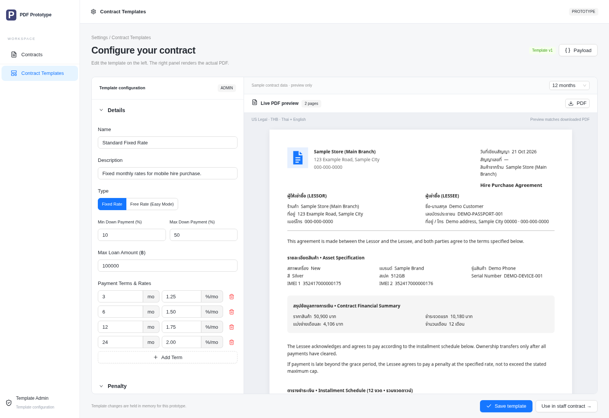

# Configurable PDF Prototype

A standalone playground for building configurable PDF contracts with React, TypeScript, Ant Design, and pdfme. Arrange document sections, change form values, preview the actual PDF, and export structured JSON for a backend.



## Run

Requires Node.js 22.12 or newer and npm.

```sh
git clone https://github.com/korawit-ch/configurable-pdf-poc.git
cd configurable-pdf-poc
npm ci
npm run dev
```

Open the URL printed by Vite. The default screen is `/settings/contract-templates`.

## Explore

1. Edit the template title, agreement text, financing rules, and penalty settings.
2. Reorder sections with the arrows. Show or hide optional sections and hover over a row to highlight its position in the PDF.
3. Enable commission to configure its percentage and wording.
4. Save the template in the demo session, then select **Use in staff contract** to try the sample contract form.
5. Review the generated PDF, inspect or download its JSON payload, and simulate a submission.

The preview displays the same PDF bytes used by the download. Documents use US Legal pages with repeated headers and signature footers. The sample includes English/Thai text and THB amounts to demonstrate localization; all business and customer data is fictional.

## Commands

```sh
npm run build       # TypeScript checks and production build
npm test            # Domain and PDF-layout checks
npm run verify:pdf  # Generate example PDFs and JSON payloads
npm run format      # Format source files
```

## Structure

- `src/features/contracts/components`: template editor, PDF preview, sample contract form, and submission review.
- `src/features/contracts/domain`: schemas, fictional fixtures, financial calculations, schedules, and serializers.
- `src/features/contracts/lib/pdf.ts`: structured section-to-PDF renderer.
- `src/features/contracts/lib/document-layout.ts`: document geometry, sample company details, and optional image assets.
- `src/features/contracts/lib/contracts-api.ts`: injectable API boundary with a simulated adapter.
- `examples`: generated PDF documents and JSON request examples.

See [INTEGRATION.md](INTEGRATION.md) for using the components in another application.

## Demo limitations

The prototype uses one sample device and template, keeps state in memory, and simulates submission. It does not provide authentication, inventory lookup, customer lookup, uploads, payments, electronic signing, or a real backend. Role labels illustrate the workflow without enforcing permissions.

Identity and QR areas use empty placeholders unless image data is supplied through `DocumentContext.assets`. The demo generates no payable QR code. Financial rules and legal wording are examples that require review before production use.

The browser verification script uses the execution environment’s Chromium and Playwright paths; adapt those paths for your own browser-test setup. PDF rendering adds bundle weight, so consider lazy loading or server-side rendering when integrating it into a larger application.

## Fonts

The bundled regular and bold `ContractSans` fonts combine Noto Sans and Noto Sans Thai. License notices are in `public/fonts/LICENSE.txt`.
